<p align="center">
  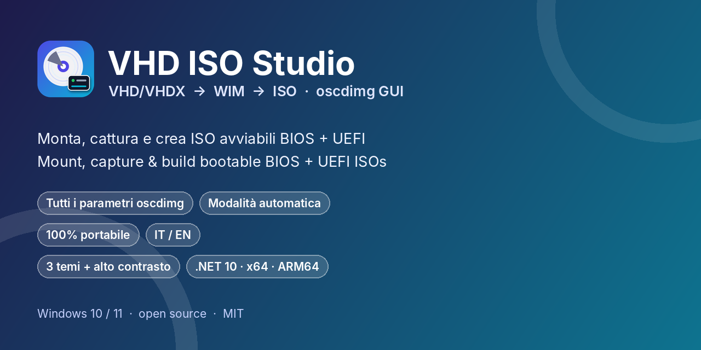
</p>

<p align="center">
  <a href="../../actions/workflows/build.yml"></a>
  
  
  
  
  
  <a href="LICENSE"></a>
</p>

<p align="center">
  <b>Monta un VHD/VHDX, cattura il contenuto e crea un'ISO con <code>oscdimg</code> — tutti i parametri, oppure un clic.</b><br>
  <i>Mount a VHD/VHDX, capture its content and build an ISO with <code>oscdimg</code> — every parameter, or one click.</i>
</p>

<p align="center">
  🇮🇹 <a href="#-italiano">Italiano</a> · 🇬🇧 <a href="#-english">English</a> · 📸 <a href="#-screenshot">Screenshot</a> · ⬇️ <a href="#%EF%B8%8F-download">Download</a>
</p>

---

## 📸 Screenshot

> Immagini generate dall'app reale sul runner Windows della CI (`VhdIsoStudio.exe --screenshots`), con **dati di esempio**.
> *Images rendered by the real app on the CI Windows runner, with **sample data**.*

<table>
  <tr>
    <td width="50%">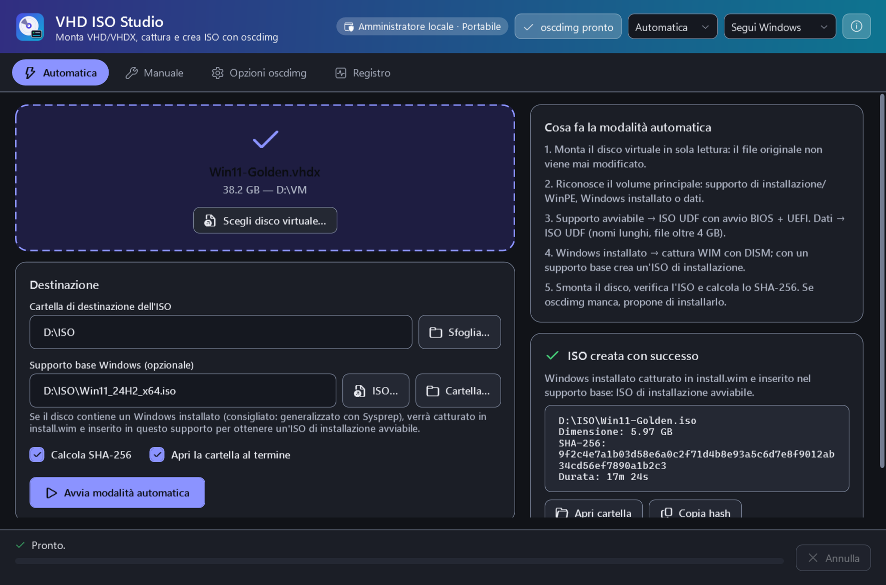<br><sub><b>Automatica</b> · tema Scuro · IT</sub></td>
    <td width="50%">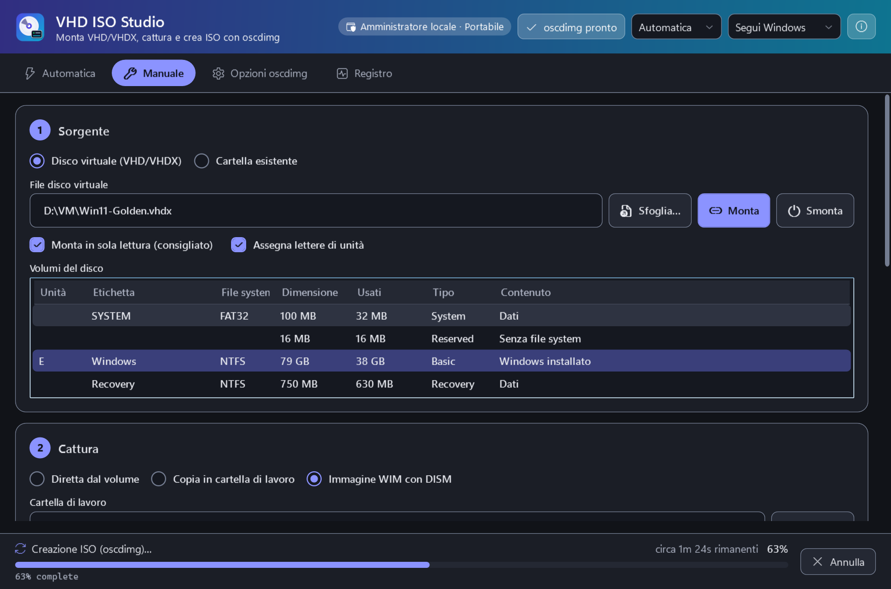<br><sub><b>Manuale</b> con avanzamento e ETA · Scuro · IT</sub></td>
  </tr>
  <tr>
    <td>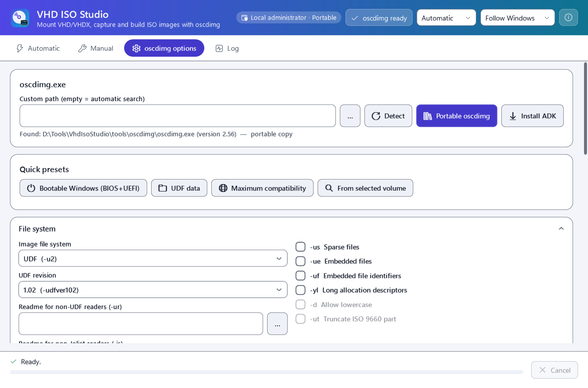<br><sub><b>oscdimg options</b> · Light · EN</sub></td>
    <td>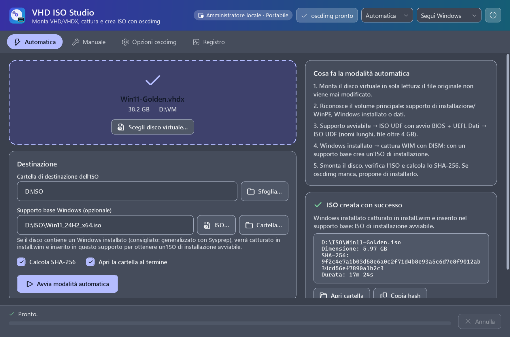<br><sub><b>Automatica</b> · tema Intermedio · IT</sub></td>
  </tr>
</table>

<details>
<summary>Altri screenshot / More screenshots</summary>

| | |
|---|---|
| 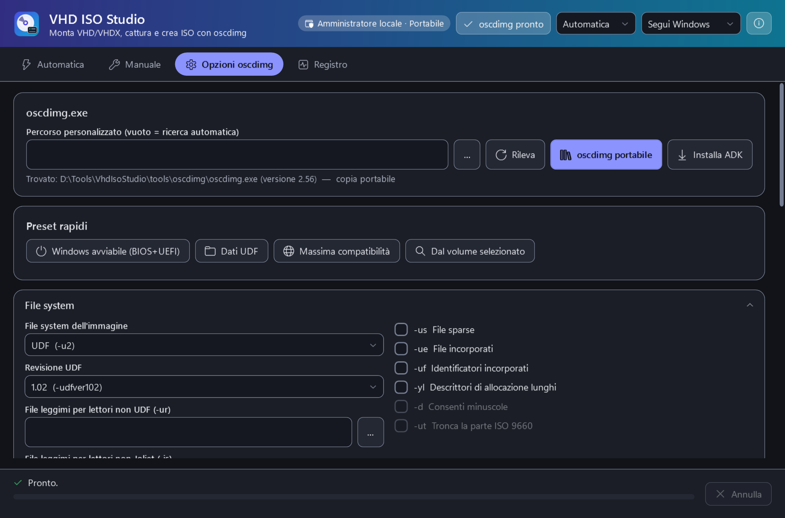 | 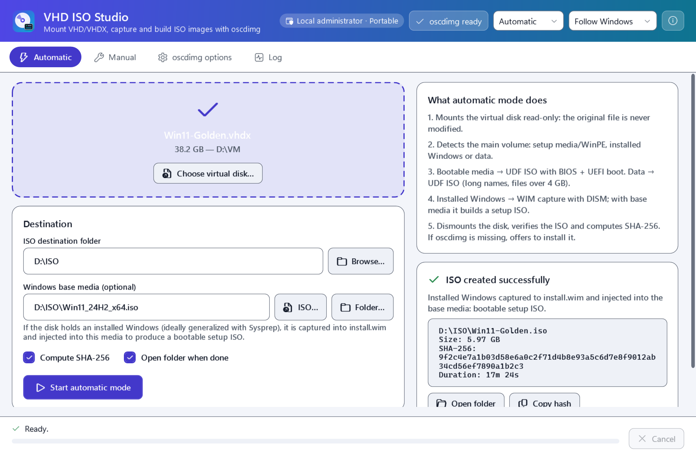 |
| 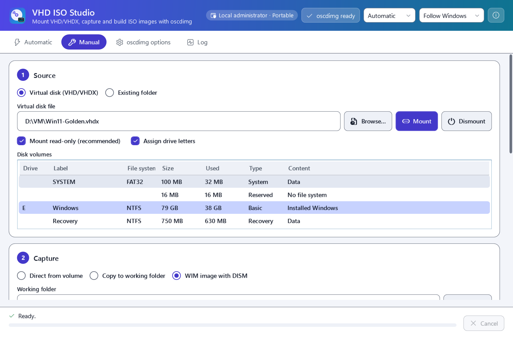 | 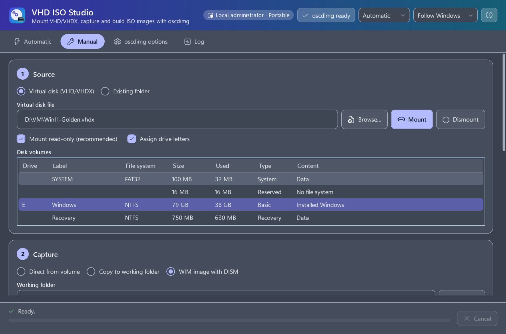 |
| 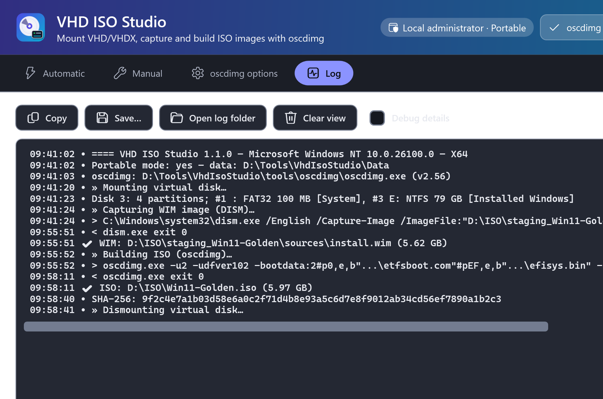 | |

</details>

---

## ⬇️ Download

| File | Per chi / For |
|---|---|
| **`VhdIsoStudio_<ver>_win-x64_portable.zip`** | ⭐ consigliato · recommended (Windows x64) |
| `VhdIsoStudio_<ver>_win-arm64_portable.zip` | Windows su ARM (Snapdragon, Surface Pro X, …) |
| `VhdIsoStudio_<ver>_<rid>.exe` | exe singolo · single file |

I file si trovano nelle **[Releases](../../releases)** o negli *Artifacts* dell'ultima **[build](../../actions/workflows/build.yml)**. Ogni file ha il suo `.sha256`.

```powershell
# verifica l'integrità / verify integrity
(Get-FileHash .\VhdIsoStudio_1.2.0_win-x64_portable.zip -Algorithm SHA256).Hash
```

---

## 🇮🇹 Italiano

### Avvio rapido
1. Estrai lo ZIP portabile in una tua cartella, anche su chiavetta USB (**non** in Program Files).
2. Avvia `VhdIsoStudio.exe` e conferma l'UAC: serve un account amministratore, locale o di dominio.
3. Trascina un `.vhdx` nella zona centrale e premi **F5**.
4. Al primo uso, se manca oscdimg, scegli **Sì = portabile**: viene scaricato da Microsoft in `tools\oscdimg`, senza installare nulla.

### Come funziona la modalità automatica
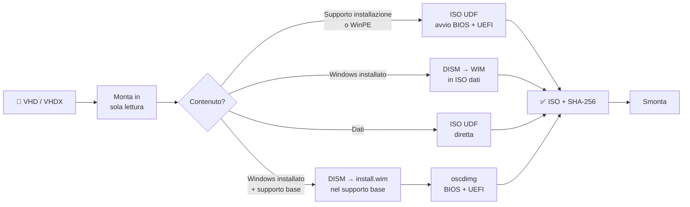

### Funzionalità
| | Funzione | Dettagli |
|---|---|---|
| 💽 | **Montaggio** | VHD/VHDX tramite il modulo Storage di Windows, in **sola lettura** di default. Lettere assegnate automaticamente; opera solo su dischi `File Backed Virtual`; porta online i dischi su Windows Server (SAN policy); smonta tutto all'uscita, anche dopo un errore. |
| 📦 | **Cattura** | **Diretta** dal volume; **copia** con robocopy (esclusi pagefile, hiberfil, cestino, System Volume Information); **WIM** con DISM (`/Compress`, `/CheckIntegrity`, `/Verify`, `/Bootable`, `/NoRpFix`, `/EA`, `/ConfigFile`). |
| 🧩 | **Supporto base** | Il WIM catturato diventa `sources\install.wim` di un supporto Windows (ISO o cartella), per ottenere un'**ISO d'installazione avviabile**. |
| ⚙️ | **oscdimg completo** | Tutte le opzioni di oscdimg 2.56: file system (`-u1 -u2 -j1 -j2 -n -nt -d -uv -ut`), UDF (`-udfver102/150/200 -us -ue -uf -yl -ur`), Joliet (`-js`), boot (`-b -p -e`, `-bootdata` BIOS+UEFI, load segment), ottimizzazione (`-o -oc -oi -os`), ordine (`-y5 -yo`), messaggi (`-w1…-w4 -yd -a`), generali (`-l -t -g -h -c -y6 -yw -k -q -m -maxsize -r`) più argomenti extra. Anteprima del comando, validazione dei conflitti, preset. |
| 🎒 | **100% portabile** | `Data\` accanto all'exe (impostazioni, log, download, scratch DISM); `tools\oscdimg\` con oscdimg e file di boot; nessuna estrazione in `%TEMP%` (ZIP). |
| 🔐 | **Sicurezza** | Solo amministratori (manifest + controllo interno); firma Authenticode Microsoft verificata su adksetup e oscdimg; cartelle di lavoro pericolose bloccate; nessun riavvio mai. |
| 🎨 | **Interfaccia** | WPF moderna; temi Scuro / Intermedio / Chiaro / Segui Windows; barra del titolo coordinata; avanzamento con ETA anche in taskbar; drag & drop (anche da Esplora non elevato); istanza singola; IT/EN al volo. |
| ♿ | **Accessibilità** | Tastiera completa e tasti Alt+lettera; anello di focus ben visibile; nomi UI Automation per screen reader; annunci di stato; contrasti **WCAG AA** verificati; Alto contrasto; DPI Per-Monitor V2; "Riduci animazioni". |

### Scorciatoie
| Tasti | Azione | Tasti | Azione |
|---|---|---|---|
| `F5` / `Ctrl+Invio` | Avvia | `Ctrl+1…4` | Cambia scheda |
| `Esc` | Annulla | `Ctrl+L` | Italiano ↔ English |
| `Ctrl+O` | Scegli disco | `Ctrl+T` | Tema successivo |
| `Ctrl+M` / `Ctrl+U` | Monta / Smonta | `Ctrl+Maiusc+C` | Copia comando oscdimg |
| `Ctrl+Maiusc+P` | oscdimg portabile | `Ctrl+I` | Installa ADK nel sistema |
| `Ctrl+Maiusc+L` | Cartella log | `F1` | Informazioni e guida |

### Struttura portabile
```
VhdIsoStudio\
├─ VhdIsoStudio.exe            app + runtime .NET 10
├─ *_cor3.dll                  librerie native WPF (niente estrazione in %TEMP%)
├─ Data\                       settings.json, Logs\, Downloads\, Work\  (creata al primo avvio)
└─ tools\oscdimg\              oscdimg.exe, etfsboot.com, efisys.bin, efisys_noprompt.bin
```
Un file vuoto `no-portable.txt` accanto all'exe riporta i dati in `%ProgramData%` e `%LOCALAPPDATA%`.

### Riga di comando
```
VhdIsoStudio.exe disco.vhdx                       precompila la sorgente
VhdIsoStudio.exe --auto disco.vhdx [cartella]     avvia subito la modalità automatica
VhdIsoStudio.exe --selftest                       verifica risorse ed esce (0 = ok)
VhdIsoStudio.exe --screenshots <cartella>         genera gli screenshot della documentazione
```

### Problemi comuni
| Sintomo | Soluzione |
|---|---|
| SmartScreen: "Windows ha protetto il PC" | L'exe non è firmato: **Ulteriori informazioni → Esegui comunque**. Verifica lo SHA-256. |
| "Nessun volume leggibile" | Volume BitLocker bloccato, disco vuoto o file system non supportato. Sblocca BitLocker o verifica il contenuto. |
| Montaggio fallito, file in uso | Il VHDX è usato da una VM accesa o da un altro programma: spegni la VM. I dischi differenziali (`.avhdx`) non sono supportati. |
| oscdimg portabile non riuscito | Proxy o firewall. Riprova, oppure **Installa ADK** e poi di nuovo **oscdimg portabile** (copia dall'ADK installato). Log in `Data\Logs`. |
| L'ISO d'installazione non parte su altri PC | L'immagine catturata dovrebbe essere generalizzata con **Sysprep** prima della cattura. |
| Il trascinamento da Esplora non funziona | Trascina sulla finestra principale, oppure usa **Ctrl+O** (l'app è elevata e Windows limita il drag & drop). |

### Compilare dai sorgenti
Requisiti: Windows 10/11 e [.NET 10 SDK](https://dotnet.microsoft.com/download). Lo script propone di installare l'SDK con winget.
```powershell
.\build.ps1 -Runtime win-x64,win-arm64      # oppure doppio clic su build.bat
```
In `dist\` trovi l'exe singolo e lo ZIP portabile, ciascuno con il suo `.sha256`. Su Linux o macOS puoi eseguire solo i controlli statici, non la build dell'exe: `bash tools/verify.sh` e `dotnet test tests/VhdIsoStudio.Tests`.

---

## 🇬🇧 English

### Quick start
1. Extract the portable ZIP to a folder of yours (USB stick is fine, **not** Program Files).
2. Run `VhdIsoStudio.exe` and accept UAC (administrator account, local or domain).
3. Drop a `.vhdx` on the central area and press **F5**.
4. On first use, if oscdimg is missing, choose **Yes = portable**: it's downloaded from Microsoft into `tools\oscdimg`, nothing gets installed.

### Highlights
- 💽 **Mounting**: read-only VHD/VHDX through the Windows Storage module. Only `File Backed Virtual` disks are touched, and everything is dismounted on exit.
- 📦 **Capture**: direct from the volume, robocopy staging, or a DISM WIM image (optionally injected into Windows base media as `sources\install.wim` → bootable setup ISO).
- ⚙️ **Every oscdimg 2.56 option**, with live command preview, conflict validation and presets; BIOS + UEFI `-bootdata`.
- 🤖 **Automatic mode** with content detection (setup media / WinPE / installed Windows / data).
- 🎒 **100% portable**: `Data\` and `tools\oscdimg\` next to the exe. oscdimg is fetched from Microsoft (Authenticode-verified) via a Deployment Tools layout + `msiexec /a` extraction, so no install is needed.
- 🎨 Dark / Medium / Light / System themes + High Contrast; IT/EN live switching; taskbar progress with ETA.
- ♿ Full keyboard support, access keys, UI Automation names, live status, WCAG AA contrast, Per-Monitor V2 DPI, reduce-motion option.

**Shortcuts:** `F5` start · `Esc` cancel · `Ctrl+O` choose disk · `Ctrl+M/U` mount/dismount · `Ctrl+1…4` tabs · `Ctrl+L` language · `Ctrl+T` theme · `Ctrl+Shift+C` copy command · `Ctrl+Shift+P` portable oscdimg · `Ctrl+I` install ADK · `Ctrl+Shift+L` logs · `F1` about.

**Troubleshooting:** see the table in the Italian section. Common cases: SmartScreen on an unsigned exe → *More info → Run anyway*; locked BitLocker volume; a VM still using the VHDX; Sysprep before capturing a setup image.

**Build:** `.\build.ps1 -Runtime win-x64,win-arm64` (needs .NET 10 SDK) → single exe + portable ZIP in `dist\`.

---

## 🏗️ Architettura / Architecture
```
src/VhdIsoStudio/
├─ App.xaml(.cs)              avvio, controllo admin, istanza singola, errori globali, --selftest/--screenshots
├─ MainWindow.xaml(.cs)       interfaccia, scorciatoie, drag & drop, avanzamento
├─ Core/
│  ├─ DiskImageService.cs     Mount/Dismount-DiskImage, partizioni, rilevamento contenuto
│  ├─ JobEngine.cs            pipeline: robocopy, DISM, oscdimg, SHA-256, auto
│  ├─ OscdimgOptions.cs       modello di tutti i parametri + riga di comando + validazione
│  ├─ PortableTools.cs        oscdimg portabile (copia dall'ADK o layout + msiexec /a)
│  ├─ AdkInstaller.cs         download con verifica firma, installazione ADK, ripiego winget
│  ├─ ThemeManager.cs         temi, alto contrasto, barra del titolo DWM
│  └─ Loc.cs / Strings.cs     IT/EN con cambio lingua a caldo
└─ Themes/                    palette Dark/Light/Medium + stili
tools/                        verify.sh (XAML + compilazione su Linux), icona, social preview
tests/                        test unitari xUnit
```

## 📚 Fonti / Sources
- Opzioni di oscdimg: output di `oscdimg -help` v2.56 ([mirror](https://cnman.github.io/oscdimg.html)) · [Microsoft Learn — Oscdimg Command-Line Options](https://learn.microsoft.com/windows-hardware/manufacture/desktop/oscdimg-command-line-options)
- ADK: [Install the Windows ADK offline](https://learn.microsoft.com/windows-hardware/get-started/adk-offline-install) · manifest winget [Microsoft.WindowsADK](https://github.com/microsoft/winget-pkgs/tree/master/manifests/m/Microsoft/WindowsADK)
- oscdimg portabile (layout ADK + MSI "Oscdimg (DesktopEditions)"): [winutil #3313](https://github.com/ChrisTitusTech/winutil/discussions/3313) · [tiny11builder #42](https://github.com/ntdevlabs/tiny11builder/issues/42)
- [DISM image management options](https://learn.microsoft.com/windows-hardware/manufacture/desktop/dism-image-management-command-line-options-s14) · [Mount-DiskImage](https://learn.microsoft.com/powershell/module/storage/mount-diskimage)

## 📄 Licenza / License
[MIT](LICENSE). oscdimg, DISM e il Windows ADK sono componenti Microsoft con licenze proprie e **non** sono inclusi. / oscdimg, DISM and the Windows ADK are Microsoft components under their own licenses and are **not** bundled.
